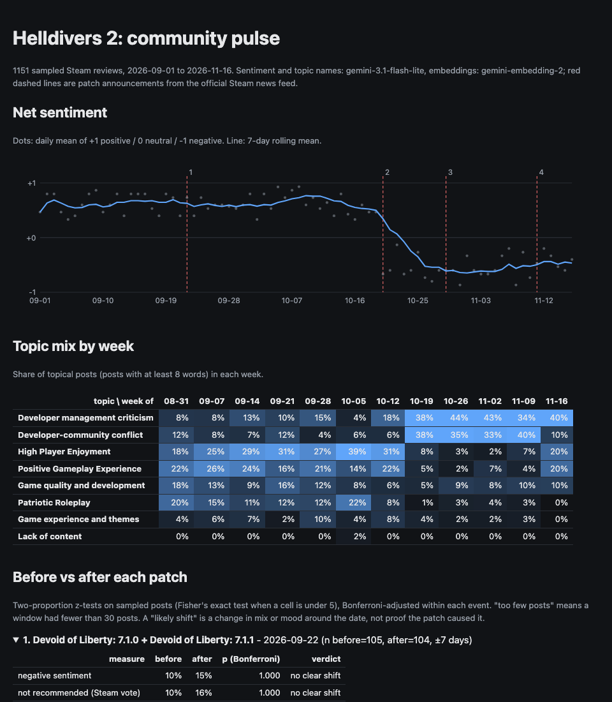

# community-pulse

Track what a game's players talk about and how they feel about it, lined up against patch dates.

## Try it

**[Live dashboard: Helldivers 2, Sep to Nov 2026](https://oguzhanozfe.github.io/community-pulse/)**: a real run on 1,151 Steam reviews.
Second example: [Cyberpunk 2077, Sep to Nov 2026](https://oguzhanozfe.github.io/community-pulse/cyberpunk2077.html) (810 reviews).

[](https://oguzhanozfe.github.io/community-pulse/)

```bash
python -m community_pulse demo        # Python 3.10+, stdlib only, no key needed
```

`demo` reruns the whole pipeline on the bundled Helldivers 2 data and writes `out/demo/dashboard.html`.
It picks a model backend by itself:

1. `GEMINI_API_KEY` set (or `CP_PROVIDER` chosen): that cloud model;
2. `--live` passed and a local Ollama at `127.0.0.1:11434` has `qwen3.5:9b` and `qwen3-embedding:0.6b`
   pulled: local models (a full local run takes several minutes);
3. otherwise **replay** of the recorded `gemini-3.1-flash-lite` / `gemini-embedding-2` responses in
   [`examples/helldivers2/replay.json.gz`](examples/helldivers2/replay.json.gz), printed as
   `mode: replay (recorded ..., 2026-11-17)` with a hint on how to run live. Replay takes about a second
   and reproduces the committed `result.json` and dashboard byte for byte. CI runs it on every push.

## What it does

community-pulse samples Steam reviews day by day and pulls official patch announcements from the Steam
news feed. It then:

1. labels every post's sentiment (positive / negative / neutral, with a confidence) with an LLM,
2. groups longer posts into topics (embedding clusters, each named by an LLM),
3. builds daily and weekly time series per topic, and
4. compares the 7 days before each patch with the 7 days after: sample sizes, two-proportion tests,
   Bonferroni correction, Fisher's exact test for small cells, and an explicit "too few posts" verdict instead of a guess.

The output is a `result.json` and a static `dashboard.html` (inline SVG, no JavaScript, no CDN).

## Why

Live-ops teams usually read sentiment as a gut feeling from a Discord channel, or as a single review
score. The useful questions are narrower. What did people start talking about after 7.2.0? Did the
complaints move from crashes to anti-cheat? Is that change bigger than the noise? This tool answers
those with numbers and their sample sizes, and it says when the sample is too small to answer.

## Use a real model on your own data

Steam reviews and news need no key.

```bash
# 1. Sample reviews (keyless public Steam Web API, ~1.5 s between calls)
python -m community_pulse fetch-steam --appid 553850 --start 2026-09-01 --end 2026-11-17 --out data/hd2.json

# 2. Analyse (needs a model backend, see below) and build the dashboard
python -m community_pulse run --input data/hd2.json --game "Helldivers 2" --out out/hd2

# 3. Sentiment accuracy on the hand-labelled set
python -m community_pulse eval
```

Tests run offline with no key and no model: `python -m unittest -v`.

**Model backends** (all optional for the demo). Every backend is called through its OpenAI-compatible API.

| env | default | options |
| --- | --- | --- |
| `CP_PROVIDER` (chat) | `gemini` (`GEMINI_API_KEY`) | `deepseek` (`DEEPSEEK_API_KEY`), `ollama` (local, no key) |
| `CP_EMBED_PROVIDER` | `gemini` | `openrouter` (`OPENROUTER_API_KEY`, free `nvidia/nemotron-3.5-embed-8b:free`), `ollama` |
| `CP_CHAT_MODEL` / `CP_EMBED_MODEL` | `gemini-3.1-flash-lite` / `gemini-embedding-2` (256 dims) | any model the backend serves |

Every model response is cached on disk in `.cache/`, keyed by a hash of the model and the input, so a
rerun spends no quota. Sentiment is requested in batches of 150 posts per call to fit free-tier
request limits. Keys are read from the environment only and are never written to results.

**Reddit (optional adapter, not in the demo).** `fetch-reddit --subreddit Helldivers` uses Reddit's
official OAuth API (app-only `client_credentials`, `REDDIT_CLIENT_ID` / `REDDIT_CLIENT_SECRET`). It stays
at 1 request/s and honours the `X-Ratelimit-*` headers. No Reddit app was available while this was built,
so the adapter is tested only against `fixtures/reddit_listing_synthetic.json`. That fixture is
**synthetic**: it is hand-written to the documented Listing shape and is not real Reddit data.

## Measured results

### Sentiment accuracy

The set is 110 Steam reviews (55 Helldivers 2 and 55 Cyberpunk 2077), drawn at random with seed 42
from the example data and labelled positive / negative / neutral from the text alone. The labels are
in [`eval/labels.jsonl`](eval/labels.jsonl) and the scores in [`eval/results.json`](eval/results.json).

| method | model | accuracy (95% CI) | macro-F1 |
| --- | --- | --- | --- |
| LLM | `gemini-3.1-flash-lite` (Gemini API) | **74.5%** (65.7–81.8%) | **0.67** |
| lexicon baseline | built-in word list with negation | 63.6% (54.3–72.0%) | 0.61 |
| always "positive" | none | 64.5% | 0.26 |

- The LLM is right more often than the lexicon (32 vs 20 discordant items), but on 110 items that gap
  is **not statistically significant** (exact McNemar p = 0.13).
- Almost all LLM errors involve **neutral**. It got 15 of 15 negatives right, but mixed reviews ("love
  it, but the devs…") get pushed to a pole, and some short positive reviews get called neutral. Only
  7 of 24 neutral items were labelled neutral.
- The self-reported confidence is weakly calibrated: 86% accuracy on 81 items at ≥ 0.9, 30% on
  23 items at 0.7–0.9.
- **About the labels.** A Claude Sonnet subagent drafted the labels by reading every review, and I
  (Claude Opus) reviewed all 110. **No human annotator was involved.** Treat this as a sanity check,
  not a benchmark. About ten items are genuinely ambiguous, and those carry a `note`.

## Example: Helldivers 2, 1 Sep to 16 Nov 2026 (real run)

[`examples/helldivers2/`](examples/helldivers2/) holds the input (1,151 English Steam reviews,
up to 15 per day, fetched 2026-11-17), `result.json` and `dashboard.html`. Models: sentiment and
topic names by `gemini-3.1-flash-lite`, embeddings by `gemini-embedding-2` (256 dims). Both are
recorded in `result.json`.

**Sanity check at scale.** On the 1,022 reviews it labelled positive or negative, the LLM matched the
reviewer's own thumbs up/down 98.2% of the time. The lexicon baseline matched 78.5%, but only on the
674 reviews it did not call neutral. Steam's vote is not ground truth for text sentiment, but it is
a large-sample check that the labels track something real.

**Before vs after patches** (±7 days, Bonferroni-adjusted within each event):

| patch (Steam announcement) | n before / after | negative share | verdict |
| --- | --- | --- | --- |
| 7.1.0 + 7.1.1 (22 Sep) | 105 / 104 | 10.5% → 15.4% | no clear shift |
| **7.2.0 + 7.2.1 (20 Oct)** | 104 / 105 | **18.3% → 73.3%** | **likely shift** (p_adj < 0.001) |
| 7.2.2 (29 Oct) | 105 / 105 | 74.3% → 76.2% | no clear shift |
| 7.2.3 (11 Nov) | 105 / 90 | 69.5% → 65.6% | no clear shift |

Around 7.2.0, two developer-criticism clusters grew from 4 to 32 and from 10 to 31 posts out of
about 105 (p_adj < 0.001 and 0.003). Their most distinctive words are *arrowhead, devs, fix, mods,
update*. The same week's Steam news includes "Changing anti-cheat in HELLDIVERS 2", and 30 of the 105
sampled reviews in the week after mention anti-cheat, against 3 of 104 the week before (a regex count). The tool reports the association only.
It does not establish that the anti-cheat change caused the shift. The share of thumbs-down votes
moved the same way (15.4% → 76.2%), independently of the LLM labels.

**Topic quality is mixed.** Two of the 8 clusters are near-duplicates (both developer criticism), one
holds a single post, and the names are LLM summaries. The distinctive-word lists are shown next to
each name for that reason.

## Example: Cyberpunk 2077, 24 Sep to 16 Nov 2026 (real run)

[`examples/cyberpunk2077/`](examples/cyberpunk2077/) holds 810 English Steam reviews (up to 15 per day),
`result.json` and `dashboard.html`. Models: sentiment and topic names by `gemini-3.1-flash-lite`;
embeddings by `nvidia/nemotron-3.5-embed-8b:free` through OpenRouter (256 dims), because the Gemini
embedding quota ran out mid-run. All 409 topical posts were embedded with that one model, so the
clusters are consistent. Topic clusters are therefore not comparable one-to-one with Helldivers 2's.

- **Sanity check:** the LLM matched the reviewer's thumbs up/down on 97.2% of 690 polar reviews;
  the lexicon matched 96.7% of 478.
- **Update 2.5 (Edgerunners 2):** three announcements within 3 days were merged into one event,
  anchored on the first one (the REDstreams preview, 20 Oct). With 105 reviews on each side, the
  negative share went from 5.7% to 7.6% and no measure shifted (every p_adj = 1.0). Reviews of this
  game were overwhelmingly positive before and after the update.

## Data handling

- Kept: post text, timestamp, vote/score, Steam's thumbs up/down, and the review or post id.
  Dropped at ingest: author ids, usernames, playtime and every other author field.
- Slurs are masked as `[slur]` at ingest, so the committed examples don't republish them.
- Steam data comes from the documented Steam Web API (`IUserReviewsService/GetAppReviews`,
  `ISteamNews/GetNewsForApp`), called with a descriptive User-Agent, at most one request per 1.5 s,
  and with backoff on 429. `api.steampowered.com/robots.txt` disallows crawlers. This tool calls the
  documented API endpoints and does not crawl pages. The older `store.steampowered.com/appreviews`
  JSON endpoint now redirects to the store front page and is not used.
- Reddit: official OAuth API only, no scraping, and no data was collected.

## Known limits

- **Sampling caps volume.** Each day contributes at most 15 reviews (Steam's "most recent" order for
  that day), so the series show mix and mood, not how much people posted. A review-bomb shows up as
  a change in tone, not in count.
- **Steam reviews are not forum talk.** Reviews skew toward verdicts, and neutral or off-topic
  posts are mostly memes. Reddit would add discussion, but it is untested against the live API.
- **Before/after is association, not cause.** Patches cluster with sales, warbonds and news. Windows
  can overlap when patches are less than 14 days apart, and announcements within 3 days are merged.
- **Free-tier quota.** About 20 requests per day per Gemini model, shared, which is why the Cyberpunk 2077
  run uses a different embedding model. Large sentiment batches (150 posts per call) keep a full run to
  about 10 chat calls.
- **Merged events are anchored on the first announcement** in the group, which can be a preview a few
  days before the actual release.
- **Topics depend on k** (8 by default) and on which posts are long enough (≥ 8 words). Cluster
  names are LLM summaries, so read the listed distinctive words next to them.
- **The eval set is small and AI-labelled** (see above). English only.
- The lexicon baseline is deliberately simple (about 150 words). A stronger baseline such as VADER
  would narrow the gap.

## Layout

```
community_pulse/
  sources.py    Steam reviews/news + Reddit OAuth client; author fields never stored
  models.py     OpenAI-compatible chat/embeddings, disk cache, LLM + lexicon sentiment
  analysis.py   k-means, topic naming, time series, event windows and tests
  pipeline.py   end-to-end run
  dashboard.py  static HTML
  evaluate.py   accuracy, CIs, McNemar, calibration
fixtures/       recorded Steam responses (authors replaced) + synthetic Reddit listing
eval/           labels.jsonl, results.json
examples/       real runs: input.json, result.json, dashboard.html, replay.json.gz
docs/           GitHub Pages copy of the Helldivers 2 dashboard + screenshot
```

MIT licensed.
